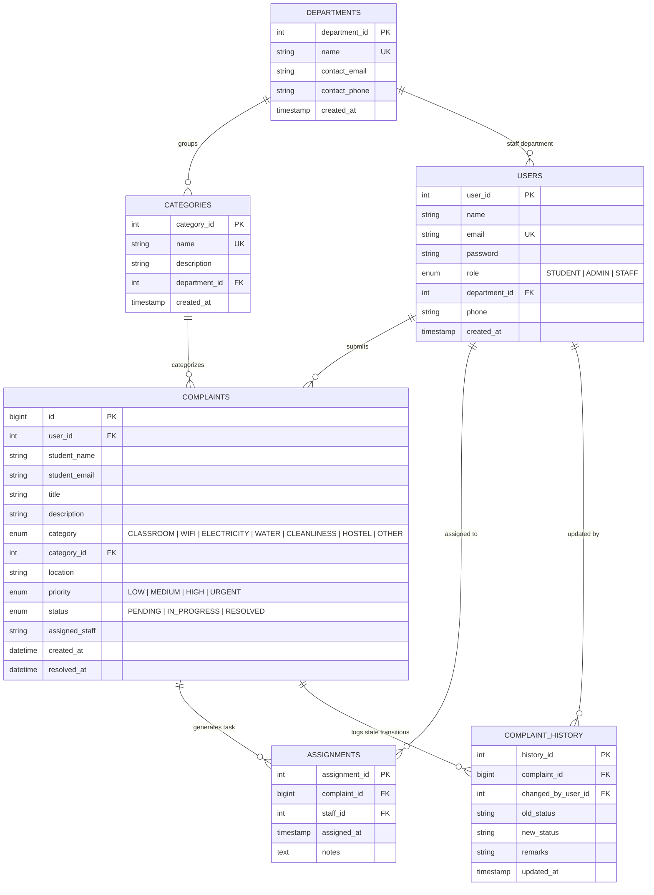

# Entity Relationship (ER) Diagram

## Smart Campus Complaint Management System

This document describes the relational architecture, entity attributes, primary/foreign keys, and cardinalities.

---

### Mermaid ER Diagram

---

### Relationship Cardinalities

| Parent Entity | Child Entity | Cardinality | Relationship Purpose |
|---|---|---|---|
| `DEPARTMENTS` | `CATEGORIES` | 1 to Many (1:N) | A campus department manages multiple grievance categories. |
| `DEPARTMENTS` | `USERS` | 1 to Many (1:N) | Staff users are assigned to specific maintenance departments. |
| `USERS` | `COMPLAINTS` | 1 to Many (1:N) | A student can raise multiple complaints over time. |
| `CATEGORIES` | `COMPLAINTS` | 1 to Many (1:N) | Each complaint belongs to a specific category. |
| `COMPLAINTS` | `ASSIGNMENTS` | 1 to Many (1:N) | A complaint is assigned to one or more technical staff members. |
| `USERS (Staff)` | `ASSIGNMENTS` | 1 to Many (1:N) | A staff member handles multiple assigned complaint tickets. |
| `COMPLAINTS` | `COMPLAINT_HISTORY` | 1 to Many (1:N) | Full historical log of status changes for auditing. |
